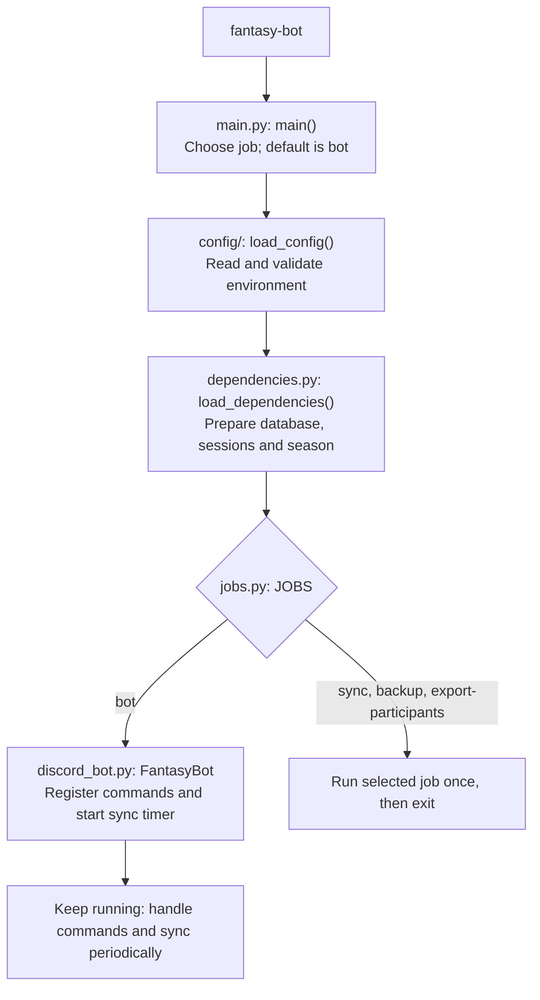
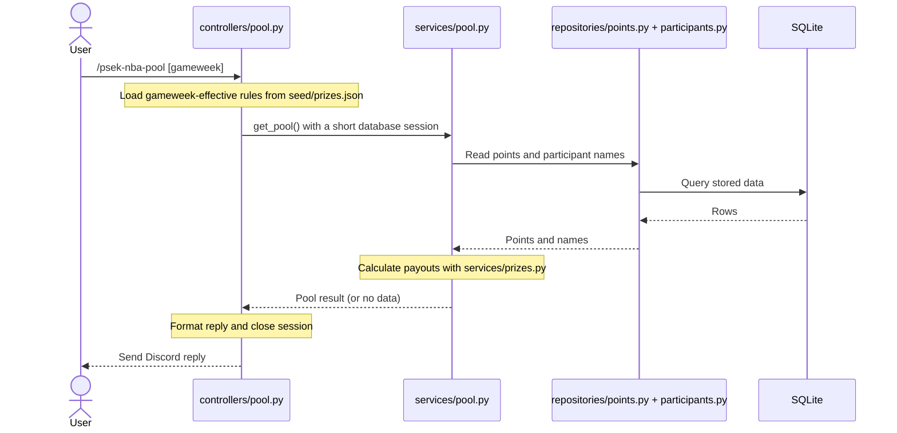

# fantasy-bot

Discord bot that summarizes an [NBA Fantasy](https://nbafantasy.nba.com) league, shows NBA schedules,
and settles the friends' betting pool.

Reading the code? Start with [Program flow](#program-flow), then use [Layout](#layout) to find files.

## Run it locally

1. Create the Discord bot (once).
   - Go to https://discord.com/developers/applications and click **New Application**.
   - **Bot** tab: click **Reset Token** and copy the token. No privileged intents are needed.
   - **OAuth2 → URL Generator**: tick scopes `bot` and `applications.commands`, then the bot permission
     `Send Messages`. Open the generated URL and add the bot to a test server.
2. Get the IDs.
   - Server ID: in Discord, turn on **Settings → Advanced → Developer Mode**, then right-click your
     server and choose **Copy Server ID**.
   - League ID: the number in your league's URL on nbafantasy.nba.com.
3. Configure and start.

   ```bash
   cp .env.example .env    # then fill in DISCORD_TOKEN, DISCORD_GUILD_ID, LEAGUE_ID
   uv run --env-file .env fantasy-bot
   ```

The bot creates `bot.db` on first start. Type `/psek-nba-money` in your server to check it responds.

## Sync nbafantasy data

The bot syncs every 10 minutes on its own. To sync once by hand and exit:

```bash
uv run --env-file .env fantasy-bot sync
```

A sync stores games and per-player stats for every day that has started, and picks for every
registered participant. Days nbafantasy marks final are never fetched again, except to backfill a
participant who registered later. Each sync rebuilds every team's day total from picks × player
stats and logs a warning if it differs from nbafantasy's official total.

## Run with Docker

```bash
docker compose up -d --build          # start the bot, restarting it if it crashes
docker compose run --rm bot sync      # one sync, same database
docker compose logs -f bot
```

The database lives in the `bot-data` volume at `/data/bot.db`, so it survives rebuilds.

## Deploy to AWS Lightsail

One small Ubuntu server running the container. The bot only makes outgoing connections, so the
server needs no open ports except SSH.

1. **In AWS** (once): set a Budget alert (e.g. $10/month). Create a Lightsail instance:
   Linux/Unix, **Ubuntu 24.04**, the smallest plan **with IPv4**, region Singapore. Paste
   `deploy/setup.sh` into **Add launch script**, turn on **automatic snapshots**, and attach a
   static IP. In the instance's Networking tab keep only SSH (22), ideally limited to your IP.
2. **Wait** a few minutes for the launch script; it logs to `/var/log/cloud-init-output.log`.
   It installs everything it needs (git, curl, cron, Docker), so a bare image is fine, but it
   only supports Ubuntu and Debian: on Amazon Linux it stops with a message saying so.
   (Without a launch script, SSH in and run `curl -fsSL
https://raw.githubusercontent.com/phakawatfong/psek-bot/main/deploy/setup.sh | sudo bash`.)
3. **Copy secrets and start**, from your computer:

   ```bash
   scp .env ubuntu@<server-ip>:/opt/psek-bot/.env
   ssh ubuntu@<server-ip> 'chmod 600 /opt/psek-bot/.env && cd /opt/psek-bot && docker compose up -d --build'
   ```

4. **Say who's in the pool**: create `seed/participants.csv` on the server (see
   [Participants](#participants)). Until it exists the pool stays as it is, and the bot logs a
   warning on every sync.

Stop any bot you run locally first: two processes with the same token both answer commands.

**Update** to the latest code: `ssh ubuntu@<server-ip> 'cd /opt/psek-bot && git pull && docker
compose up -d --build'`. Run git as `ubuntu`, not with `sudo`: the repo belongs to `ubuntu`, and
git refuses to work in it as root. **Logs**: `docker compose logs -f bot` (capped at 30MB).

**Backups**: Lightsail snapshots the whole server daily. Separately, cron runs `fantasy-bot
backup` at 03:00 UTC, writing `/data/backups/bot-YYYY-MM-DD.db` in the volume and keeping 14
days. To restore one: `docker compose stop bot`, copy the chosen backup over `/data/bot.db`
(`docker compose run --rm --entrypoint cp bot /data/backups/bot-2026-10-25.db /data/bot.db`),
then `docker compose start bot`.

## Commands

Every command is listed in one routes table, `src/fantasy_bot/controllers/routes.py`, and every
name starts with `psek-nba-`.

| Command | Shows |
|---|---|
| `/psek-nba-standings [gameweek]` | Eligible teams ranked by that week's points after transfer costs, with the gap to the leader |
| `/psek-nba-money [gameweek] [season]` | Weekly net win/loss; `season:true` shows finalized weeks and accumulated totals |
| `/psek-nba-pool [gameweek]` | Weekly points, buy-ins, shares, payouts and net win/loss |
| `/psek-nba-chart [by]` | `day` shows season cumulative points; `gameweek` shows points for each eligible week |
| `/psek-nba-schedule [gameweek] [day]` | NBA matches with Bangkok tip-off times; gameweek alone shows the whole week |

Standings, money and pool default to the **current fantasy gameweek**, determined by the synced
fantasy deadlines. They never silently fall back to an older week if current points are missing.
For example, `/psek-nba-money gameweek:2` shows GW2's net results, while
`/psek-nba-money season:true` shows the accumulated season total. Do not combine `gameweek`
with `season:true`. Weekly results are provisional until every day is `data_checked`; only
finalized weeks contribute to accumulated money. Before the first deadline, the default uses
the first fantasy week; after the season ends, select a gameweek explicitly or use `season:true`.

**Schedule selection:**

| Example                               | Shows                                 |
| ------------------------------------- | ------------------------------------- |
| `/psek-nba-schedule`                  | Current fantasy gameweek and day      |
| `/psek-nba-schedule day:3`            | Day 3 of the current fantasy gameweek |
| `/psek-nba-schedule gameweek:2 day:3` | Day 3 within gameweek 2               |
| `/psek-nba-schedule gameweek:2`       | Every day in gameweek 2               |

Day numbers restart at 1 each gameweek. The current fantasy day starts at its deadline and
lasts until the next day's deadline, even if its games have finished; it is not determined by
Bangkok midnight. Before the season starts, the default shows the first day as upcoming.
After the final fantasy day finishes, select a gameweek explicitly.

The schedule fetches directly from nbafantasy when requested, so future fixtures do not depend
on a background sync. Replies show `away @ home`, dates and times in Bangkok (UTC+7), completed
scores, and `Time TBD` for unannounced times. All games on the selected day remain visible,
including completed games. Empty days and unavailable schedules get an explanatory reply;
long replies are split into messages.

**Team logos:** schedule replies show NBA team logo emojis beside the abbreviations. At startup,
the bot reuses its existing `nba_<TEAM>` application emojis and uploads missing logos from
ESPN's image CDN. These belong to the bot application, not a particular server. No manual
emoji IDs or database setup are needed. Existing emojis are never replaced or deleted.

Emoji setup is limited to 60 seconds. If a download or upload fails, the schedule still shows
the team abbreviation; missing logos are retried on the next bot restart. No extra recurring
job is added. The first start after this update may take longer while logos are uploaded.

## Participants

Who is in the pool is one file: `seed/participants.csv`. Every sync (every 10 minutes, and when the
bot starts) makes the pool match it exactly.

```csv
entry_id,from_gameweek,name
10001,2,alpha
10002,2,bravo
10003,2,charlie
```

- `entry_id`: the number in the team's nbafantasy URL, e.g. `nbafantasy.nba.com/entry/31818`.
- `from_gameweek`: the first gameweek they pay into and play for.
- `name`: optional, only to make the file readable.
- Lines starting with `#` and blank lines are ignored.

| To                                           | Do                                                                                        |
| -------------------------------------------- | ----------------------------------------------------------------------------------------- |
| Add someone                                  | Add a row                                                                                 |
| Fix someone's start week                     | Change their `from_gameweek`                                                              |
| Remove someone                               | Delete their row                                                                          |
| Apply it now instead of within 10 minutes    | `docker compose run --rm bot sync` (or `uv run --env-file .env fantasy-bot sync` locally) |
| Create the file from who's in the pool today | `docker compose run --rm bot export-participants > seed/participants.csv`                 |

Two safety rules: a **missing file** changes nothing, and **any bad row** (a typo, a duplicate, a
team not in the league) means nothing changes. Either way the sync log says why, with line
numbers. Moving a start week or removing someone changes the pools of the weeks it covered,
including finished ones, because money is recomputed from points.

The file is git-ignored because the repo is public; `seed/participants.example.csv` shows the
format. Docker mounts the whole `seed/` folder read-only, so any editor's save is seen.

## Weekly pool

Everyone starts paying and playing in **GW2**: set each participant's `from_gameweek` to `2`
in `seed/participants.csv`. Later joiners can start at a later week. `WEEKLY_BUY_IN` in `.env`
(default `50`) is each person's weekly buy-in.

Prize rules live in `seed/prizes.json` (`PRIZES_FILE` can override the path):

```json
[
  {"from_gameweek": 2, "weights": [120, 70, 50, 30, 20, 10]}
]
```

These numbers are **relative weights**, not fixed payouts or rounded percentages. Each place
gets `weight / sum(weights)` of that week's pool, so exact shares always total 100%.
With six people paying 50, the pool is 300:

| Place | Share | Payout | Net after buy-in |
|---|---|---|---|
| 1st | 40% | 120.00 | +70.00 |
| 2nd | 23⅓% | 70.00 | +20.00 |
| 3rd | 16⅔% | 50.00 | 0.00 |
| 4th | 10% | 30.00 | −20.00 |
| 5th | 6⅔% | 20.00 | −30.00 |
| 6th | 3⅓% | 10.00 | −40.00 |

- **One weight per person:** weights must be positive whole numbers, in descending order
  (equal weights are allowed). A seventh participant requires an explicit seven-place rule.
  A count mismatch produces an explanation; the bot never invents missing prizes or truncates
  the split. Pool and weekly money need the matching count; standings remain available.
- **Ties:** average the prizes of the places they cover. Two tied for second in this pool
  each receive `(70 + 50) / 2 = 60`.
- **Rounding:** calculate with exact fractions, then round to cents using largest remainder.
  Payouts always exhaust the pool. If a pool/split cannot give everyone at least one cent, the
  bot explains the problem instead of silently paying someone zero.
- **Changing the split:** append a rule with a later `from_gameweek` and its complete weight
  list. The latest rule starting on or before a week applies to that week. Keep older rules
  intact to preserve earlier results. Editing an earlier rule recalculates the weeks it covers.
- **Loading:** money and pool read and validate the entire file on each request, so weight
  edits need no restart. A missing or invalid file produces an explanation, not a fallback.
  Docker mounts this file through the existing read-only `seed/` mount.

Payouts are computed from synced points on every request; they are never stored. Season money
sums finalized weekly net results from GW2 onward. Weeks before the first prize rule are excluded.
The buy-in is saved when the season is created and never changes after that: changing `.env`
does not rewrite an existing season's buy-in. The bot logs a warning if they differ.

**Deploying this change:** keep `WEEKLY_BUY_IN=50` on Lightsail, update the code and
`seed/prizes.json`, and set all six entries in the server's `seed/participants.csv` to start
in GW2. The local private file has only four entries; add the two remaining entry IDs yourself.
Restart the updated bot to register the new command options, then let its first sync apply
participant changes. No database reset is required. The stored season buy-in must already be 50
for the payouts in the table above; this update does not alter it.

## Program flow

**Start at `src/fantasy_bot/main.py: main()`.** `pyproject.toml` connects the terminal command
`fantasy-bot` to this function. Paths below are relative to `src/fantasy_bot/`.

**Startup** (`uv run --env-file .env fantasy-bot`):



Locally, `uv --env-file .env` loads the environment before the program starts. Database setup
applies migrations and ensures the season exists. `controllers/routes.py` lists the slash
commands. During startup, `controllers/team_emojis.py` loads or creates optional team emojis
before the sync timer starts; emoji failures are logged and startup continues. The timer and
the standalone `sync` job both call `services/sync.py: sync_now()`.

**One command** (`/psek-nba-pool`):



Standings, money, pool and charts read stored points; sync fetches updates from nbafantasy.
Money and pool also read the gameweek-effective prize rules from the seed file.
Schedule is the exception: `controllers/schedule.py` acknowledges the request, then
`services/schedule.py` uses the existing client to fetch the calendar and selected fixtures
directly. It does not read or write the database. At startup, each controller's `handler()`
builds the callback; its inner `handle()` runs when someone uses the command.

| To change                    | Start in        |
| ---------------------------- | --------------- |
| A command's reply            | `controllers/`  |
| A calculation or sync rule   | `services/`     |
| What data is read or written | `repositories/` |

## Layout

`src/` holds application code; `fantasy_bot/` is its Python package, giving imports a clear
name such as `fantasy_bot.services.pool`. Tests, docs and deployment files live outside it.
Within the package, folders group code by responsibility:

```
src/fantasy_bot/
  main.py           start here: 1. load the config  2. load dependencies  3. run the job
  dependencies.py   step 2: the migrated database, sessions, and the season row
  jobs.py           step 3: bot, sync, backup, export-participants
  discord_bot.py    the Discord client: registers the routes, runs the sync loop
  config/           .env, one small typed config each for discord, database, league
  contracts/        nbafantasy's JSON payloads, as pydantic models (what we receive)
  models/           our own data, one file per area (what we work with)
  controllers/      one file per slash command: call a service, format the reply
                    team_emojis.py reuses and uploads Discord application emojis
  services/         one job each: standings, money, pool, chart, schedule, participants, sync;
                    prizes.py calculates payouts, prize_rules.py loads the weekly rules;
                    gameweeks.py resolves weekly defaults, chart_drawing.py draws PNGs
                    team_logos.py selects missing NBA team logos
  repositories/     SQL, one file per kind of data: calendar, points, participants, season, nbafantasy
                    queries.py holds shared SQL expressions for participant names
  clients/          HTTP calls to nbafantasy and ESPN team-logo downloads
  database/         SQLAlchemy engine and sessions, table mappings, migrations
```

Each folder imports only the ones below it: controllers → services → repositories → database,
services → clients → contracts, and everything may use models. Only controllers and
`discord_bot.py` import `discord`, and only `services/chart_drawing.py` imports matplotlib.
`tests/test_layering.py`
fails the build if any of this drifts. `tests/` mirrors `src/`.

All database access goes through SQLAlchemy: queries are `select()`/`insert()` statements on the
mappings in `database/tables.py`, and each command or sync uses its own short session. The
schema itself is the SQL in `database/migrations/` (STRICT tables, CHECKs, views);
`tests/database/test_tables.py` fails if the mappings and the migrations disagree. To change the
schema, add a migration file and update `tables.py` to match.

## Develop

```bash
uv run pytest -q
uv run ruff check . && uv run ruff format --check . && uv run mypy
```
